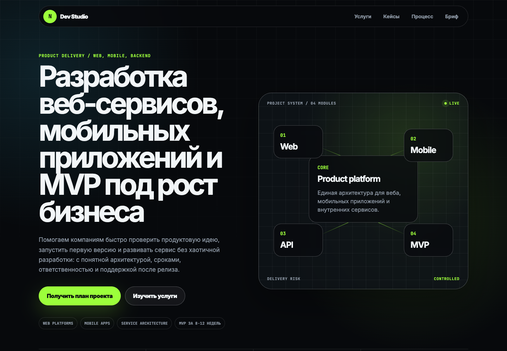
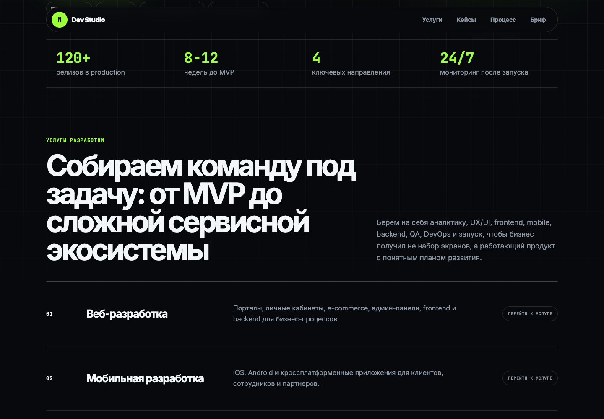
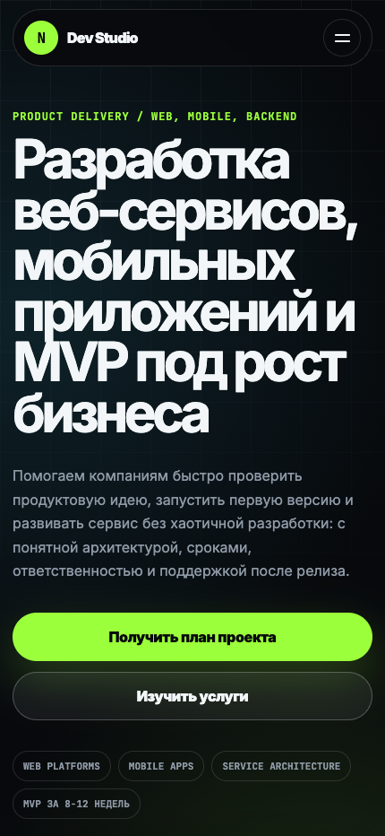

<a href="README.md">English</a> · <a href="README.ru.md">Русский</a>

<h1 align="center">Сайт студии разработки</h1>

Адаптивный сайт студии со страницами услуг и понятной формой обращения.

   

Публичная витрина закрытого проекта. Здесь представлены обезличенные интерфейсы и основные сценарии; исходный код и внутренние материалы остаются приватными.

## Основные сценарии

- Страницы услуг разработки
- Презентация кейсов и процесса
- Структурированный бриф проекта

## Галерея

Каждый экран показан отдельно с сохранением пропорций. Названия, контакты и данные заменены демонстрационными. Это визуальная презентация, а не подтверждение доступности рабочей службы.

### Обзор

### Услуги разработки

### Мобильная версия

---

[Все проекты](https://github.com/svllvsx)
